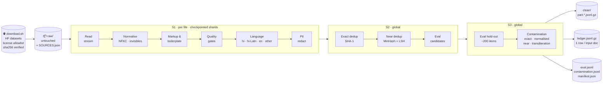
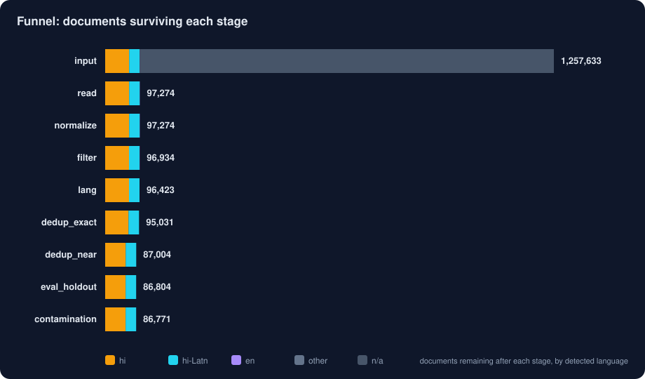
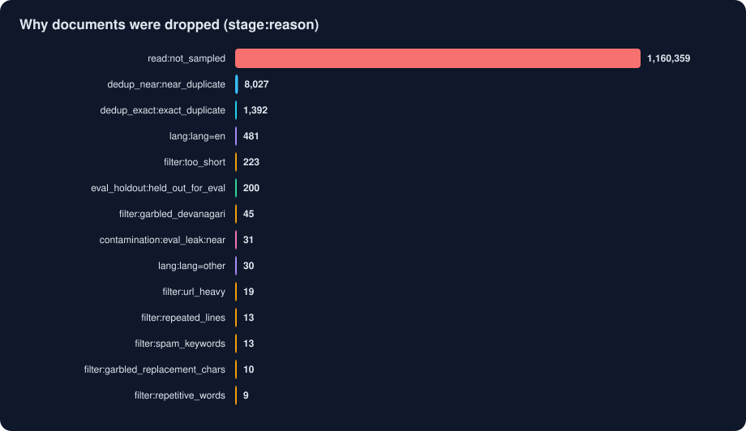
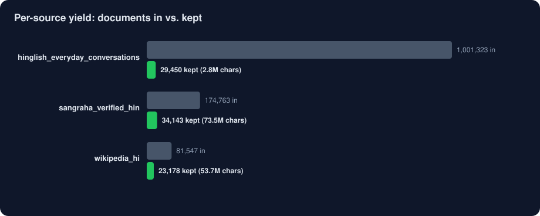
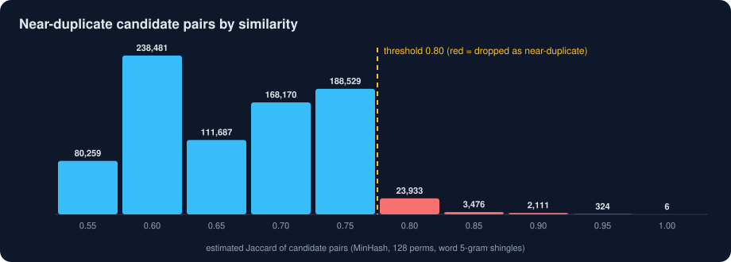

<div align="center">

```
██╗███╗   ██╗██████╗ ██╗ ██████╗
██║████╗  ██║██╔══██╗██║██╔════╝
██║██╔██╗ ██║██║  ██║██║██║
██║██║╚██╗██║██║  ██║██║██║
██║██║ ╚████║██████╔╝██║╚██████╗
╚═╝╚═╝  ╚═══╝╚═════╝ ╚═╝ ╚═════╝

 ██████╗ ██████╗ ██████╗ ██████╗ ██╗   ██╗███████╗
██╔════╝██╔═══██╗██╔══██╗██╔══██╗██║   ██║██╔════╝
██║     ██║   ██║██████╔╝██████╔╝██║   ██║███████╗
██║     ██║   ██║██╔══██╗██╔═══╝ ██║   ██║╚════██║
╚██████╗╚██████╔╝██║  ██║██║     ╚██████╔╝███████║
 ╚═════╝ ╚═════╝ ╚═╝  ╚═╝╚═╝      ╚═════╝ ╚══════╝
```

### Hindi + Hinglish training-corpus pipeline · leak-proof eval set · streaming, deterministic, restart-safe

<br>


<br>

[**Quick start**](#-quick-start) ·
[**Architecture**](#-architecture) ·
[**Results**](#-results-from-the-real-run) ·
[**Guarantees**](#-guarantees) ·
[**Walkthrough → EXPLANATION.md**](EXPLANATION.md) ·
[**Decisions → DECISIONS.md**](DECISIONS.md)

</div>

---

## ✨ What it does

Raw public text goes in. Out come a **training-ready corpus**, a **200-item held-out eval set**, and a **contamination report proving the eval never leaked** into training — with a ledger row explaining the fate of *every single input document*.

| | |
|---|---|
| 📥 **Collect** | Hindi Wikipedia, AI4Bharat Sangraha, Hinglish sources — license-allowlisted, sha256-verified, pinned revisions |
| 🧹 **Clean** | Unicode/Devanagari normalisation, markup & boilerplate repair, spam / garbled-encoding filters that protect proverbs, poems and number tables |
| 🏷️ **Label** | `hi` · `hi-Latn` · `en` · `other` from script + function-word statistics — source labels are never trusted |
| 🔁 **Dedup** | exact (SHA-1) + near-duplicate (MinHash + LSH, word 5-grams), threshold chosen by reading real pairs |
| 🔒 **Redact** | `<PHONE>` `<EMAIL>` `<AADHAAR>` (Verhoeff-checked) `<PAN>` — non-PII numbers survive |
| 🧪 **Eval** | ~200 held-out passages, checked against training by exact / normalised / near / **cross-script transliteration** matching |
| 📒 **Ledger** | one row per input doc: `kept/dropped · stage · reason · dup_of` |

---

## 🚀 Quick start

```bash
pip install -r requirements.txt          # numpy, pyarrow, pytest   (Python >= 3.10)

./download.sh raw                        # the ONLY networked step → raw/ + SOURCES.json + DOWNLOAD_LOG.json
./run.sh raw out                         # offline · deterministic · safe to kill and rerun

python tools/make_sample.py out sample/clean_sample_1000.jsonl   # 1,000-row random sample
python tools/render_numbers.py out                               # every number in DECISIONS.md, from the run
python tools/make_charts.py out docs/img                         # the figures below
python -m pytest tests -q                                        # 65 tests, synthetic fixtures only
```

Tune anything without editing code: `./run.sh raw out --set near_dup_threshold=0.7 --text-field body`

---

## 🏗 Architecture



Every stage a document can die at is named — `read · normalize · filter · lang · dedup_exact · dedup_near · eval_holdout · contamination` — and recorded in the ledger.

---

## 📊 Results from the real run

> Figures are generated by `tools/make_charts.py` straight from `out/manifest.json`. No number is typed by hand.

| | |
|---|---|
| **input documents** | 1,257,633 raw records across 3 sources (700 MB); deterministic per-source sampling → 97,274 processed |
| **clean corpus** | **86,771 docs** — 57,316 `hi` (66%) · 29,455 `hi-Latn` (34%) · 68 MB gz |
| **eval set** | 200 held-out items (150 hi · 50 hi-Latn), 4 affected by leaks → 33 training docs removed |
| **near-dups** | 8,027 dropped at est. Jaccard ≥ 0.80 (7,985 are Wikipedia template stubs) · 1,392 exact |
| **PII redacted in clean text** | 266 phones · 64 emails · 2 PAN |









Full discussion, with real examples of what the filters got wrong: [DECISIONS.md](DECISIONS.md).

---

## 🛡 Guarantees

| guarantee | how it is met |
|---|---|
| 🌊 **Streaming** | record-by-record readers (JSONL, JSON, CSV/TSV, TXT, Parquet by batch, optional gz/bz2); memory = one record + the dedup index |
| 🩹 **Malformed input never fatal** | each bad record becomes a ledger row (`stage=read`, e.g. `invalid_json`, `invalid_utf8`) and a count in `manifest.json` |
| 🎯 **Deterministic** | sorted file order · fixed seeds · CRC32 shingle ids (not salted `hash`) · mtime-free gzip · `sort_keys` JSON — a test asserts two runs give a byte-identical tree |
| ♻️ **Restart-safe** | S1 shards written to `*.tmp` and atomically renamed; S2/S3 recompute from shards and swap in at the end, `manifest.json` last — a test kills a run mid-stage and compares with an uninterrupted one |
| 🚫 **No hardcoding** | unseen schemas fall back to the longest string field; every threshold lives in `src/indic_corpus/config.py` and is overridable |
| 📴 **Offline** | `run.sh` reads only `<raw_dir>`, writes only `<out_dir>` |

---

## 📁 Output layout

| path | contents |
|---|---|
| `out/clean/part-*.jsonl.gz` | one row per kept document: `id, text, lang, source` |
| `out/ledger.jsonl.gz` | one row per input record: `id, status, stage, reason, dup_of` (+ `source, lang, chars, file, ord`) |
| `out/eval.jsonl` | held-out eval set (~200 items), never present in `clean/` |
| `out/contamination.jsonl` | one row per affected eval item: `eval_id, train_ids, method` |
| `out/manifest.json` | sources, input sha256, every threshold, counts per stage and language, output hashes |
| `out/diagnostics/` | near-dup pairs around the threshold, contamination near-misses, samples of dropped text per reason |

## 🗂 Repository map

```
download.sh · run.sh               entry points (network / offline)
sources/sources.json               declarative source list + license allowlist
src/indic_corpus/
  config.py                        every threshold, in one place
  readers.py  normalize.py         streaming input · Unicode canonicalisation
  quality.py  langid.py  pii.py    filters · language labels · redaction
  dedup.py                         MinHash + banded LSH
  evalset.py  contamination.py  translit.py     eval hold-out · leak detection (incl. cross-script)
  stage1.py   pipeline.py          orchestration, checkpoints, outputs
tools/                             download · sample · threshold study · numbers · charts
tests/                             65 tests (synthetic data only)
eval/  sample/                     eval set + 1,000-row sample of the cleaned output
DECISIONS.md  EXPLANATION.md       the write-up · the step-by-step guide
```

<div align="center">

<sub>Built for the Flam Indic-corpus assignment · data under CC-BY / CC-BY-SA · attribution in <code>raw/SOURCES.json</code></sub>

</div>
